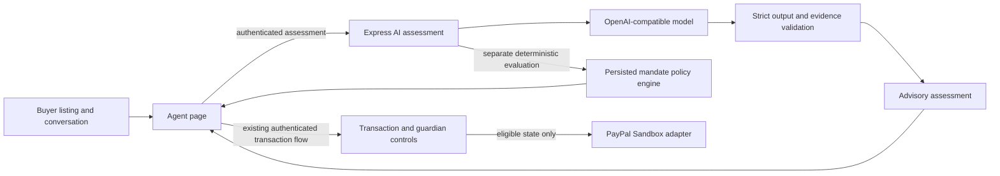

# Safe Mandate

**Autonomous purchasing. Human-controlled money.**

Safe Mandate enforces buyer-defined rules over purchase proposals. The Purchase Copilot analyzes supplied listings and seller conversations, the deterministic policy engine evaluates the buyer's persisted mandate, an accepted guardian approves valid exceptions, and the transaction-bound PayPal Sandbox workflow controls authorization, capture, and void. AI recommendations are advisory and cannot perform payment actions.

## Roles and mandate

- **Buyer** owns the purchasing mandate and transaction.
- **Agent** submits structured proposals for deterministic evaluation.
- **Guardian** reviews a valid policy exception tied to one transaction and proposal version.

Mandates include an ID, integer maximum amount in currency minor units, currency, categories, meetup requirements, expiration, guardian ID, and an AI review threshold. A high score can only add guardian review; a low score cannot bypass deterministic mandate conditions. Authenticated transaction creation strips client-supplied AI scores/evidence. The supported currency allowlist and each minor-unit exponent are in `server/src/domain/mandate/currencies.js`; INR uses 2, JPY 0, and KWD 3. No conversion to or from decimal amounts occurs in the domain.

The policy engine returns `READY_FOR_PAYMENT`, `NEEDS_GUARDIAN`, `BLOCKED`, or `EXPIRED`. Malformed proposals, invalid financial values, unsupported currencies, and currency mismatches fail closed. Client-supplied AI scores and evidence are excluded from persisted transaction proposals. A high risk score can only add guardian review and cannot override deterministic mandate conditions. A direct payment path requires stored `READY_FOR_PAYMENT` evidence from the engine for the exact mandate and proposal. The exception path requires `NEEDS_GUARDIAN` evidence, guardian approval, `GUARDIAN_APPROVED`, and then `READY_FOR_PAYMENT`.

Meetup time remains a local `HH:mm` value with a matching IANA timezone. The model does not yet contain a complete meetup date and local datetime, so the domain cannot apply date-specific daylight-saving conversion or prove that a meetup is in the future. Its window comparison is a deterministic local wall-clock comparison.

## Transaction aggregate and events

Transactions are created only by `createTransaction`. It returns a deeply frozen snapshot backed by private in-process aggregate state. `transitionTransaction` accepts only factory-issued current snapshots, checks the internal version and transition history, and returns a new frozen snapshot. Callers cannot choose an initial state or modify proposal, mandate, approval, state, or audit data. Transactions also bind explicit buyer identity and the proposal's seller identity; the identities must differ.

Every event requires a unique event ID and expected transaction version. Duplicate IDs, altered reuse of an ID, stale snapshots, and competing events from one version are rejected. A successful event increments the version and appends one audit event. Provider state advances only after a trusted adapter reports a provider result. Each transition is additionally guarded by an atomic MongoDB compare-and-set on the aggregate version, so competing server instances cannot both commit from the same version; provider-event idempotency across instances remains part of the PayPal integration phase.

## Guardian approval and trust boundaries

Approval records bind transaction ID, proposal ID, mandate ID, proposal version, canonical proposal fingerprint, guardian ID, decision, and timestamp. The proposal and approval records are immutable within the process; a new proposal requires a new transaction and evaluation. An unkeyed fingerprint is an identifier for the proposal contents, not authentication or tamper protection against a caller controlling the process.

The domain checks actor role and identity against stored buyer, seller, and nominated guardian IDs. The backend now authenticates application accounts and persists buyer-initiated guardian relationships:

- The **application layer authenticates users** and only trusted application services submit authenticated domain events. Buyer and seller sessions are implemented in `server/src/middleware/auth.js` and `server/src/services/`.
- The buyer invites an existing account; that account must sign in and accept. Acceptance designates that account as a guardian in the application and is not identity or legal guardianship verification.
- Guardian approval requires the accepted guardian, mandate designation, current transaction version, and the transaction's specific policy exception. The approval is audited and cannot itself authorize or capture payment.
- The **PayPal adapter verifies webhook signatures and retrieves authoritative payment status** before submitting provider events; these payment lifecycle endpoints remain unimplemented.

Authenticated buyer, seller and accepted guardian identity resolution exists. PayPal webhook verification and payment lifecycle endpoints do not.

## Audit limitations

Returned audit events and collections are deeply immutable, and each records event ID, transaction ID, previous and next states, event type, actor identity and role, timestamp, reason, and metadata. Rejected transitions do not append successful-transition events. Audit history is stored in the transaction document and mirrored into the append-only `TransactionAuditEvent` collection; it is not cryptographically signed, and a tamper-proof external anchor remains future work.

## Frontend and localization preview

The `client/` directory contains the mobile-first React + Vite installable PWA preview. Its centralized i18next configuration loads separate English, Hindi, and Marathi JSON catalogs from `client/src/locales/`. The language selector is available in the onboarding header and application navigation/profile settings; the selection persists in browser local storage. New languages can be added by providing a catalog and registering its locale in the centralized configuration.

Interface copy, statuses, notifications, charts, and demo summaries use translation keys with English fallback. Currency, number, and date presentation uses `Intl.NumberFormat` and `Intl.DateTimeFormat`. Manrope and Noto Sans Devanagari are bundled for Latin and Devanagari text. Product names, seller names, IDs, currency codes, and canonical backend state values remain unchanged. Language switching only affects presentation; it does not translate or mutate transaction data. The sample agent text is localized demo content; no AI model is connected.

The PWA offline worker caches only its offline document and static icons. It does not cache authentication, guardian approval, or payment data; live transaction and guardian actions require a verified online backend response. The current frontend is a local illustrative preview and does not authorize, capture, or void payments.

## Technology and status

The backend uses Node.js, plain JavaScript ES modules, Express 5, Mongoose, MongoDB, and Node's built-in test runner. The frontend uses React, Vite, i18next, and react-i18next. The Express API includes an authenticated Purchase Copilot assessment route and transaction-bound PayPal Sandbox lifecycle routes. Tests use a fake AI provider; real model use requires server-side configuration.

Phase 1 schema, authentication, and endpoint documentation is in [`docs/backend-phase1.md`](docs/backend-phase1.md).

## Backend development server

From `server/`, run `npm run dev` to start the API on `http://127.0.0.1:3001` by default. Development defaults to `mongodb://127.0.0.1:27017/safe_mandate`; production requires an explicit valid `MONGODB_URI` and `NODE_ENV=production`. Session tokens are random 256-bit values stored as SHA-256 digests, so no session secret is required. `SESSION_TTL_MINUTES` defaults to 480; `MONGODB_SERVER_SELECTION_TIMEOUT_MS` defaults to 5000. Set `PORT` or `HOST` to change bind settings, and set comma-separated `FRONTEND_ORIGINS` to customize exact CORS origins. Auth attempt limits use `AUTH_LOGIN_LIMIT`, `AUTH_REGISTER_LIMIT`, and `AUTH_RATE_WINDOW_MS`. See `server/.env.example` for placeholders. The default Vite origins are `http://127.0.0.1:5173` and `http://localhost:5173`. Vite proxies `/api` to `SAFE_MANDATE_API_ORIGIN`, which defaults to `http://127.0.0.1:3001`; the frontend API helper supports an optional `VITE_API_ORIGIN` override.

Public endpoints are `GET /api/health`, `POST /api/mandates/validate`, and `POST /api/policy/evaluate`. Policy evaluation accepts a caller-supplied proposal and mandate and returns the deterministic result marked `evaluationOnly: true` and `authorizationGranted: false`; it is advisory and never creates a transaction or payment order.

Authenticated endpoints require `Authorization: Bearer <session token>` issued by `POST /api/auth/register` or `POST /api/auth/login`: `POST /api/auth/logout`, `GET /api/auth/session`, buyer-only mandate and transaction operations, and buyer-only `POST /api/ai/assessments`. The Agent page keeps the session token in component memory and sends it in the Authorization header; it does not store it in localStorage. The server derives actor identity from the session. Example requests are in `docs/backend-phase1.md`.

## AI Purchase Copilot

The Agent page now supports buyer sign-in, a listing and seller-conversation assessment, optional saved-transaction analysis, a structured summary, evidence excerpts, missing details, seller questions, a draft message, and an optional counteroffer. The buyer reviews and copies a draft; the application never sends it automatically. The model analyzes only the supplied listing/conversation and purchase context. Email addresses and phone numbers are redacted before submission. It has no tools, external browsing, identity data, mandate internals, or payment adapter. Exact evidence excerpts are checked against the original input before results are returned.

The backend separately evaluates the proposed/persisted purchase against the buyer's actual mandate and returns that deterministic result with `evaluationOnly: true` and `authorizationGranted: false`. AI risk or recommendation does not change transaction state, mandate, guardian approval, or payment eligibility. AI assessment audit records persist provider/model, prompt version, outcome, timestamp, transaction reference, and an input digest; raw listing and conversation text are not persisted.

Configure these server-only variables in `server/.env` (the example file contains placeholders): `AI_API_KEY`, `AI_MODEL`, optional `AI_BASE_URL` (defaults to `https://api.openai.com/v1`), and optional `AI_TIMEOUT_MS` (defaults to 20,000; allowed range 1,000–60,000). The adapter uses the OpenAI-compatible Chat Completions endpoint with JSON response mode. No model is hardcoded; the model actually used is the configured `AI_MODEL`. Missing configuration produces an explicit unavailable response, never a fabricated analysis. The real provider has not been verified unless manually run with valid credentials and a supported model. [OpenAI Chat Completions API reference](https://developers.openai.com/api/reference/resources/chat).

## PayPal Sandbox lifecycle

The API implements order creation, server-side approval verification and authorization, evidence-gated capture, void, idempotent operation records, and read-only reconciliation. It uses one configured Sandbox platform merchant; seller-specific payouts and escrow are not implemented. The browser return callback is never payment proof. The AI assessment does not call PayPal. Mocked tests do not establish that a real Sandbox checkout succeeds; the live Sandbox payment lifecycle remains unverified until a deliberate manual walkthrough with buyer and merchant test accounts.

### Copilot and payment boundaries



The copilot has no execution tools and its persisted audit excludes raw listing and conversation text. The PayPal integration uses one platform Sandbox merchant identity. Seller-specific payouts and escrow are not implemented. Atlas persistence for the newly added AI audit model must be reported only after the isolated verifier succeeds.

## Run tests

```powershell
Set-Location .\server
$runId = [guid]::NewGuid().ToString('N')
$env:MONGODB_URI_TEST = "mongodb://127.0.0.1:27017/safe_mandate_phase1_test_$runId"
npm test
Remove-Item Env:MONGODB_URI_TEST
```

The persistence test skips unless `MONGODB_URI_TEST` points to a unique loopback-only test database. It rejects Atlas and the normal application database before any database cleanup. `npm run verify:atlas` is a separate, non-destructive verification command; it loads `server/.env`, creates a unique database override, and cleans only its run-specific records.

Frontend localization tests and production build:

```powershell
Set-Location .\client
npm test
npm run build
```
